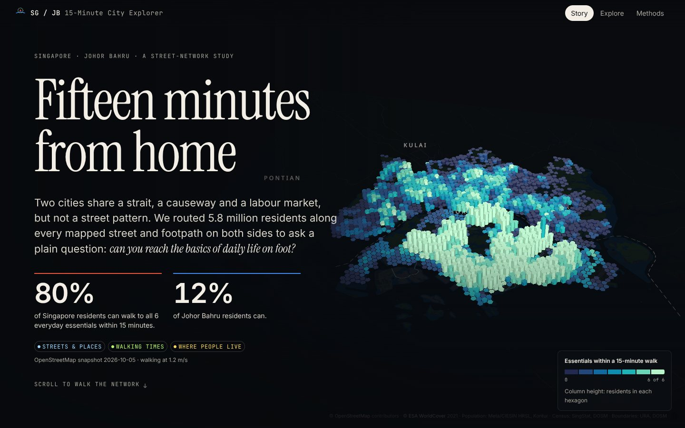
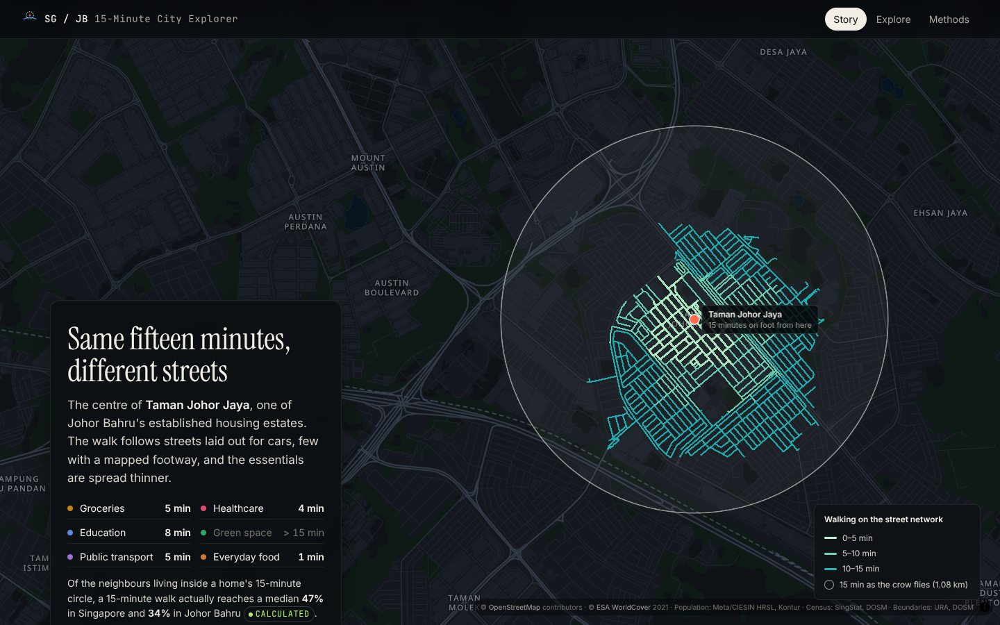
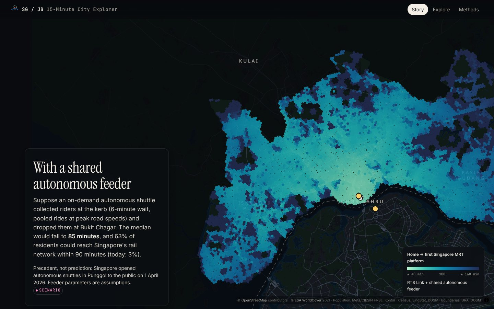
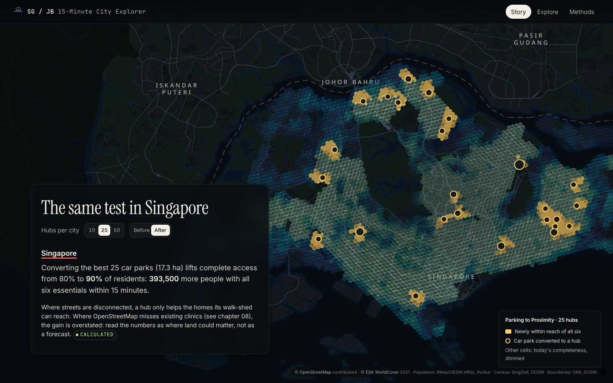

# Singapore / Johor Bahru 15-Minute City Explorer

**How far is daily life from home — and what could change it?** An open, reproducible
street-network study of walkable access to everyday essentials for 5.8 million residents of
Singapore and Johor Bahru, with scenario models for the RTS Link, shared autonomous feeders and
the conversion of car-park land into neighbourhood hubs.



**Three views of one dataset:** a scrollytelling **Story**, an interactive **Explorer** (change any
assumption, click anywhere to walk the network) and a **Methods** page generated from the data.
Run it locally with `make dev` (see below); the static build deploys to any host.

## What it found

| | Singapore | Johor Bahru |
|---|---:|---:|
| Residents (census 2020) | 4,044,340 | 1,753,284 |
| **All six essentials within a 15-minute walk** | **80.4 %** | **12.0 %** |
| Fewer than three essentials | 2.0 % | 37.9 % (657,200 people) |
| All six at a slower 0.9 m/s | 59.9 % | 5.1 % |
| Essential most often missing | healthcare | healthcare |
| Street junctions per km² · footpath share | 287 · 47 % | 98 · 11 % |

*Essentials: groceries, healthcare (clinic or pharmacy), education (school or childcare), a park of
at least 0.5 ha, public transport, everyday food. Walking on the mapped street network at 1.2 m/s.*

* **Robust.** Singapore leads in all 72 combinations of walking speed, time budget, definitions,
  network rules and population model; the gap exceeds 20 points in 70 of them.
* **Not a mapping artefact.** Re-run with Overture Places instead of OpenStreetMap destinations:
  89.5 % vs 23.0 %. OSM under-maps Johor Bahru's clinics by about two-thirds relative to Overture,
  and the story says so.
* **Different gaps.** Singapore's residents are typically one essential short (usually a clinic);
  Johor Bahru's are spread from none to all six.
* **The border is not a street.** With the RTS Link the median door-to-platform trip from a Johor
  Bahru home to a Singapore MRT platform falls from 132 to 124 minutes (central assumptions); with a
  shared autonomous feeder to the station, to 85 — the first kilometres are the slow part.
* **Parking to Proximity.** Turning 25 well-chosen car parks per city into neighbourhood hubs would
  give 393,500 more Singaporeans and 152,800 more Johor Bahru residents all six essentials within
  15 minutes (a scenario, with its caveats).

| Walk-shed vs. the 15-minute circle | RTS Link + autonomous feeder | Parking to Proximity |
|---|---|---|
|  |  |  |

## Portfolio summary

1. **Problem.** Most 15-minute-city maps draw circles and count shops. This project measures real
   walks for every resident, separates observation from modelling, and tests whether the answer
   survives other definitions.
2. **Why Singapore and Johor Bahru.** One functional region (about 327,000 crossings a day at
   Woodlands), two urban models: planned transit towns and a car-oriented metropolis of private
   estates — and a new cross-border rail link due by the end of 2026.
3. **What the data revealed.** An 80 % vs 12 % gap in complete walkable access, robust to every
   assumption tested, with healthcare as the scarcest essential in both cities.
4. **Biggest differences.** Street connectivity (3× the junctions), dedicated footpaths (4×), and
   the spread of gaps (one missing essential vs several).
5. **Interventions tested.** The RTS Link with and without a shared autonomous feeder, and
   converting car parks into neighbourhood hubs.
6. **What changed.** The RTS saves minutes; a kerbside autonomous feeder saves far more because
   access, not the crossing, dominates. Hubs help most where homes are one essential short.
7. **Implications.** Design for the slowest walker; make networks continuous before making them
   smart; treat the kerb as the interface; spend any parking dividend on proximity. See the
   [case study](docs/case-study.md).


## Run it

Requirements: Python ≥ 3.11, Node ≥ 20, [osmium-tool](https://osmcode.org/osmium-tool/) and
[tippecanoe](https://github.com/felt/tippecanoe) (basemap only).

```bash
make setup                 # .venv + web dependencies
make data                  # every source except OpenStreetMap (checksums → data/provenance.json)
make osm                   # OSM extract by streaming the dated planet, or:
make osm OSM_FROM=malaysia-singapore-brunei-latest.osm.pbf   # cut from a Geofabrik download
make pipeline              # analysis → data/derived, web/public/data, web/public/tiles
make dev                   # http://localhost:5173
make web                   # static site in web/dist (deploy anywhere)
make test                  # pytest + vitest
```

Individual stages: `python -m sgjb.pipeline networks features population access access_overture form scenarios summary export basemap`.

## Repository

```
config/            study area, network rules, essentials taxonomy, scenario parameters, data sources
src/sgjb/          the pipeline (acquire → networks → access → form → scenarios → summary → export)
tests/             pytest: graph kernels, OSM parsing, metrics, export format, output integrity
data/derived/      versioned results (summary.json, neighbourhoods, sensitivity grid, sites)
web/               Vite + React + TypeScript site: Story, Explorer, Methods
docs/              case study and architecture
```

## Documentation

* [Case study](docs/case-study.md) — problem, research, data, method, design, findings, limitations, next steps
* [Architecture](docs/architecture.md) — pipeline, static artifacts, rendering, testing
* Methods page in the site (`#/methods`) — formulas, data register, audits, sensitivity
* [Data licences](DATA_LICENSES.md) — sources and required attributions

## Licence

Code: MIT. Data and derived files: the licences of their sources (OpenStreetMap data under ODbL;
see [DATA_LICENSES.md](DATA_LICENSES.md)).
